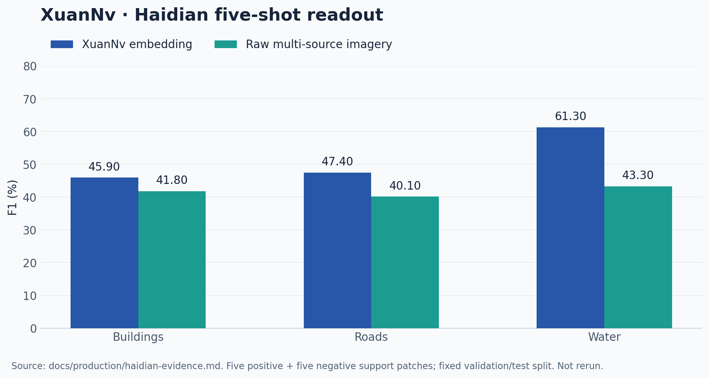

# XuanNv Embedding

[中文](README.zh-CN.md) · [Model card](docs/production/haidian-model-card.md) · [Evaluation evidence](docs/production/haidian-evidence.md)

XuanNv encodes monthly, multi-source Earth observations into reusable dense geospatial features. A 1,280 m × 1,280 m patch produces a `64 × 128 × 128` embedding for each month; lightweight task heads read the frozen representation for buildings, roads and water.

This is the maintained implementation of my XuanNv embedding work, rebuilt from an audited allowlist of the legacy repository. It includes configuration-driven data preparation, training, checkpoint-compatible export, and downstream evaluation. Large imagery, weights and embeddings live outside Git.

## What is validated

- **Haidian P10C:** the registered production baseline. Inputs include Sentinel-2, Sentinel-1, Landsat, high-resolution optical imagery and optional high-resolution SAR.
- **Harbin:** a frozen transfer evaluation with separate evidence and substantial variability; this is not a claim of successful nationwide generalisation.
- **China configuration:** a data pilot, not a completed national training run.



Reported fixed-split results from [the evidence summary](docs/production/haidian-evidence.md): five positive and five negative support patches per task, with unchanged validation/test splits. Thresholds are selected on validation and reported on test. This chart is not a new run. Full supervision and cross-region transfer have different outcomes; see the full evidence and [Harbin limitations](docs/production/harbin-transfer.md).

## Install and inspect the CLI

Python 3.11 is required. From a clone of this repository:

```bash
pip install .
xuannv --help
```

Optional workflows:

```bash
pip install ".[data-process]"
pip install ".[downstream]"
pip install ".[npu,data-process]"  # Ascend environment with CANN configured
```

The CLI can be inspected without training. Actual training/export requires the registered model and data assets and an appropriate compute environment.

## Model workflow

```bash
xuannv data --help
xuannv train --help
xuannv export --help
xuannv downstream --help

xuannv train --config configs/production/haidian_p10c_v1.yaml \
  --output /path/out/checkpoint.pt

xuannv export --config configs/production/haidian_p10c_v1.yaml \
  --checkpoint /path/to/haidian_embedding_v1_p10c_epoch800.pt \
  --compatibility-profile haidian_p10c_v1 --region haidian \
  --output-root /path/out/embeddings --device npu:0
```

The registered Haidian checkpoint is loaded with its compatibility profile; do not substitute an older experimental checkpoint. See the [model card](docs/production/haidian-model-card.md) and [artifact manifest](docs/production/artifacts.json) for hashes and asset paths.

## Read the implementation

- [Architecture and module boundaries](docs/architecture.md)
- [Configuration and manifest contract](docs/configuration-and-manifest.md)
- [Data preparation](docs/data-processing.md)
- [Training, export and downstream evaluation](docs/training-export-downstream.md)
- [Haidian model card](docs/production/haidian-model-card.md) and [evidence](docs/production/haidian-evidence.md)
- [Harbin transfer evidence and limits](docs/production/harbin-transfer.md)
- [Migration and provenance](MIGRATION.md)
- [NPU release checklist](docs/release/npu-checklist.md)

Artifacts are hosted at [ModelScope](https://modelscope.cn/datasets/WeijieWu/xuannv_haidian_embdding), subject to the dataset's existing access conditions.

## Tests and licence

```bash
pip install ".[dev]"
python -m pytest tests/
```

Tests and release checks are described in the repository; data-dependent or NPU-dependent workflows need their stated assets and environment. Code is [Apache-2.0](LICENSE). See [CONTRIBUTING](CONTRIBUTING.md) and [SECURITY](SECURITY.md).
